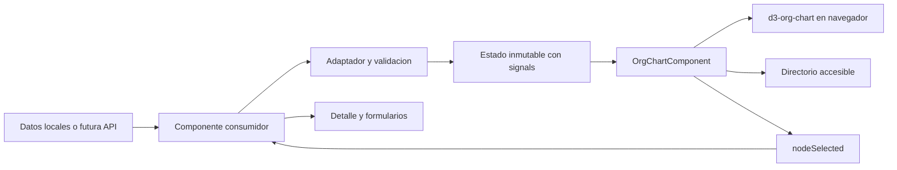

# POC de Organigrama Reutilizable

Prueba de concepto en Angular para representar jerarquias con `d3-org-chart`,
seleccionar nodos y administrar sus datos desde componentes consumidores.
Incluye un componente visual generico, funciones puras para operaciones CRUD
y dos pantallas de ejemplo: procesos con participantes y un editor independiente.

**Estado:** POC funcional. El codigo reutilizable esta dentro de la aplicacion;
todavia no es un paquete Angular publicado. No requiere Storybook ni un backend.

## Contenido

- [Alcance y limites](#alcance-y-limites)
- [Stack tecnico](#stack-tecnico)
- [Instalacion y ejecucion](#instalacion-y-ejecucion)
- [Instalar y configurar d3-org-chart](#instalar-y-configurar-d3-org-chart)
- [Arquitectura y archivos](#arquitectura-y-archivos)
- [Componente reutilizable](#componente-reutilizable)
- [Demo independiente](#demostracion-independiente-sin-storybook)
- [API publica](#api-publica)
- [Procesos y participantes](#ejemplo-implementado-procesos-y-participantes)
- [Integracion con una API](#adaptar-un-modelo-de-api)
- [Funciones CRUD](#funciones-auxiliares)
- [Personalizacion de datos y vistas](#guia-de-personalizacion-donde-modificar)
- [SSR y despliegue](#ssr-y-despliegue)
- [Pruebas y verificaciones](#pruebas-y-verificaciones)
- [Seguridad y accesibilidad](#seguridad-y-accesibilidad)
- [Solucion de problemas](#solucion-de-problemas)
- [Evolucion hacia una biblioteca](#evolucion-hacia-una-biblioteca)

## Alcance y Limites

| Implementado | Detalle |
| --- | --- |
| Componente generico | `OrgChartComponent<T>` recibe datos, configura tarjetas y emite seleccion. |
| Jerarquia validada | IDs unicos, una raiz, padres existentes y ausencia de ciclos. Lista vacia permitida. |
| CRUD inmutable | Funciones para crear, editar y eliminar nodos; borrado de ramas con cascada explicita. |
| Navegacion del grafico | Zoom, ajuste, expansion y contraccion. |
| Seleccion y detalle | Panel lateral en la demo generica y detalle del proceso en la pantalla principal. |
| Modelo de negocio separado | Adaptador de procesos, personas y cargos al contrato visual. |
| Renderizado compatible con SSR | La estructura Angular se renderiza sin D3; el grafico se inicializa en el navegador. |
| Alternativa al SVG | Directorio con botones seleccionables mediante teclado. |

No estan implementados: persistencia, servicios HTTP de negocio, autenticacion,
autorizacion, arrastrar para cambiar de padre, exportacion, virtualizacion,
plantillas Angular dentro de las tarjetas ni publicacion npm de la biblioteca.
La pantalla de procesos permite crear procesos y administrar asignaciones;
el CRUD generico completo se demuestra en `/demo/org-chart`.

Los datos viven en memoria: navegar entre pantallas o recargar puede recrear
los ejemplos. No se garantiza rendimiento para un volumen concreto de nodos;
debe medirse con los datos del sistema destino.

## Stack Tecnico

Versiones declaradas en [package.json](package.json), no necesariamente las
versiones exactas resueltas en cada instalacion:

| Tecnologia | Version declarada | Responsabilidad |
| --- | --- | --- |
| Angular / Router / Forms | `^21.2.0` | Componentes standalone, signals, rutas y formularios reactivos. |
| Angular CLI / Build / SSR | `^21.2.10` | Desarrollo, compilacion, prerenderizado y servidor Angular. |
| TypeScript | `~5.9.2` | Contratos genericos y comprobacion estatica. |
| d3-org-chart | `^3.1.1` | Distribucion y renderizado de la jerarquia. |
| @lucide/angular | `^1.61.0` | Iconos de los controles. |
| Tailwind CSS | `^4.1.12` | Pantalla de procesos y estilos globales. |
| Express | `^5.1.0` | Servidor de la compilacion SSR. |
| Vitest / jsdom | `^4.0.8` / `^28.0.0` | Pruebas unitarias y de integracion de componentes. |

El proyecto declara `npm@11.12.1` como gestor. Para un entorno nuevo, utiliza
una version de Node compatible con Angular 21, por ejemplo Node 22 desde
`22.12.0` o Node 24. Los tipos `@types/node` no fijan la version del runtime.

## Instalacion y Ejecucion

Desde la carpeta del repositorio:

```bash
npm install
npm start
```

El repositorio incluye [package-lock.json](package-lock.json). Usa `npm ci`
en CI o para una instalacion reproducible cuando este sincronizado con
[package.json](package.json). No necesitas instalar Angular CLI globalmente.

| URL local por defecto | Pantalla |
| --- | --- |
| http://localhost:4200/ | Procesos, participantes y cargos. |
| http://localhost:4200/demo/org-chart | Demo generica con CRUD y panel lateral. |

Para usar otro puerto:

```bash
npm start -- --port 4202
```

En ese caso la demo queda en **http://localhost:4202/demo/org-chart**.
El servidor de desarrollo recompila al cambiar los archivos.

### Comandos Disponibles

| Comando | Uso |
| --- | --- |
| `npm start` | Servidor Angular de desarrollo. |
| `npm run build` | Compilacion de produccion de navegador y servidor. |
| `npm run watch` | Compilacion continua en configuracion de desarrollo; no inicia un servidor web. |
| `npm test` | Ejecucion de pruebas con el comportamiento interactivo del runner. |
| `npm test -- --watch=false` | Ejecucion de pruebas una sola vez. |
| `npm run serve:ssr:POC_organigrama` | Servir una compilacion existente mediante Node y Express. |
| `npm run ng -- generate component nombre` | Generar un componente con el CLI local. |

## Instalar y Configurar d3-org-chart

`d3-org-chart` es la libreria externa que dibuja el organigrama. No debe
confundirse con `OrgChartComponent`, que es el componente Angular de esta POC
y agrega entradas tipadas, seleccion, controles y validacion de la jerarquia.

### 1. Instalar las Dependencias

**En este repositorio**, basta con ejecutar `npm install` o `npm ci`: las
dependencias ya estan declaradas. No necesitas repetir la instalacion manual.

**En otro proyecto Angular**, desde su carpeta raiz, instala la libreria y
los tipos usados por esta POC:

```bash
npm install "d3-org-chart@^3.1.1"
npm install --save-dev "@types/d3-org-chart@^3.1.2" "@types/d3@^7.4.3"
```

El primer paquete se utiliza en ejecucion; los paquetes `@types` proporcionan
declaraciones para TypeScript y no contienen el motor de renderizado.
Estas versiones reproducen los rangos declarados en la POC, no una garantia
de compatibilidad con cualquier version futura de Angular o de la libreria.

Si reutilizas tambien el componente completo de esta POC, instala sus iconos:

```bash
npm install "@lucide/angular@^1.61.0"
```

No hace falta agregar scripts CDN ni registrar D3 en `scripts` de
[angular.json](angular.json). Esta integracion usa modulos npm y carga dinamica.
Tampoco necesitas instalar el paquete `d3` por separado para usar el codigo
actual; si escribes imports directos desde `d3`, declaralo como dependencia
directa de tu propio proyecto.

### 2. Integrar el Componente Angular

Para trasladar el componente a otra aplicacion, copia la carpeta
[src/app/org-chart](src/app/org-chart), conservando el archivo TypeScript,
la plantilla, los estilos, el modelo y su punto de exportacion.
No copies los modelos de procesos si no los necesitas. El chart tiene estilos
propios: Tailwind no es un requisito para su barra, directorio o tarjetas.

Ejemplo de un consumidor situado en `src/app`, con la carpeta copiada al mismo nivel:

```typescript
import { ChangeDetectionStrategy, Component, signal } from '@angular/core';
import { OrgChartComponent, OrgNode } from './org-chart';

@Component({
	selector: 'app-mi-organigrama',
	imports: [OrgChartComponent],
	template: `
		<app-org-chart
			[nodes]="nodes()"
			[nodeWidth]="280"
			[nodeHeight]="140"
			[height]="560"
			[selectedNodeId]="selected()?.id ?? null"
			(nodeSelected)="selected.set($event)"
		/>
		@if (selected(); as node) {
			<aside aria-label="Detalle del nodo">
				<h2>{{ node.name }}</h2>
				<p>{{ node.role }}</p>
			</aside>
		}
	`,
	changeDetection: ChangeDetectionStrategy.OnPush,
})
export class MiOrganigrama {
	readonly nodes = signal<readonly OrgNode[]>([
		{ id: 'direccion', parentId: null, name: 'Direccion', role: 'Estrategia' },
		{ id: 'equipo', parentId: 'direccion', name: 'Equipo tecnico', role: 'Desarrollo' },
	]);
	readonly selected = signal<OrgNode | null>(null);
}
```

Registra este consumidor en una ruta o importalo en el componente que lo
muestre. No necesitas proveedores especiales para D3 ni un NgModule de la
libreria. La seleccion del ejemplo es suficiente para datos fijos; para un
editor, conserva el ID y deriva el nodo con `computed`, como hace la demo.

### 3. Entender la Configuracion Interna de D3

La integracion ya esta implementada en
[src/app/org-chart/org-chart.ts](src/app/org-chart/org-chart.ts).
No crees una segunda instancia de D3 sobre el mismo contenedor.

| Punto de configuracion | Implementacion y motivo |
| --- | --- |
| Tipado | `import type { OrgChart as D3OrgChart } from 'd3-org-chart'` permite tipar la instancia sin ejecutar la libreria al importar el componente. |
| Carga en navegador | `afterNextRender()` inicia `initialize()`, que ejecuta `await import('d3-org-chart')`. D3 no se inicializa durante SSR. |
| Contenedor | `viewChild` obtiene el `<div #chartHost>`; `initialize()` le asigna un ID unico y lo conecta mediante `.container(...)`. Esto separa varias instancias en una pagina. |
| Instancia | `new OrgChart<OrgNode<T>>()` crea el motor del grafico. |
| Animacion | `.duration(0)` desactiva las transiciones en esta POC. Cambia ese valor en `initialize()` si necesitas otra duracion. |
| Expansion inicial | `.initialExpandLevel(3)` configura los niveles visibles al cargar. |
| Dimensiones | El `effect` traduce `nodeWidth`, `nodeHeight` y `height` a `.nodeWidth(...)`, `.nodeHeight(...)` y `.svgHeight(...)`. |
| Tarjetas | `.nodeContent(...)` llama al renderizador del componente; devuelve HTML construido con `createElement` y `textContent`. |
| Clic | `.onNodeClick(...)` recupera el nodo original por ID y emite `nodeSelected`. |
| Datos | `.data(nodes.map(node => ({ ...node }))).render()` entrega copias superficiales a D3 para no modificar los nodos originales. |
| Destruccion | `DestroyRef.onDestroy()` llama a `clear()` y vacia el contenedor. |

Las propiedades `id` y `parentId` del contrato ya coinciden con la jerarquia
esperada por esta integracion. Para datos con otros nombres, usa
`buildOrgNodes` como adaptador en lugar de modificar la libreria instalada.
Valida una sola raiz, padres existentes e IDs unicos antes de renderizar.

Para actualizar el grafico, cambia el signal con `nodes.set(...)` o
`nodes.update(...)`, devolviendo otro arreglo. El componente ejecuta `render()`
por ti; no necesitas buscar el SVG ni redibujarlo desde el consumidor.

### 4. Comprobar la Integracion

En esta POC, ejecuta:

```bash
npm start
```

Abre **http://localhost:4200/demo/org-chart** y verifica que aparecen los nodos,
que los controles de zoom funcionan y que un clic actualiza el panel lateral.
Despues ejecuta `npm run build` para comprobar tambien la compilacion SSR.

Si integras el componente en otra aplicacion:

- **No encuentra el modulo o sus tipos:** comprueba `npm ls d3-org-chart @types/d3-org-chart @types/d3` y que instalaste las dependencias en la raiz correcta. No ocultes el problema declarando el modulo como `any`.
- **Error de `document` o `window` durante SSR:** evita imports de ejecucion e inicializacion de D3 en el ambito global; conserva la carga dinamica dentro de `afterNextRender()`.
- **Grafico vacio o recortado:** comprueba el ancho del contenedor, el input `height`, los datos y la jerarquia; prueba el control de ajustar a pantalla. Un arreglo vacio es un estado permitido.
- **Las tarjetas no muestran nuevas propiedades:** guardar datos no los presenta automaticamente; configura `cardFields` o `nodeContent()` segun la [guia de personalizacion](#guia-de-personalizacion-donde-modificar).

## Arquitectura y Archivos



| Archivo | Responsabilidad actual |
| --- | --- |
| [src/app/app.ts](src/app/app.ts) | `App` aloja el router; `ProcessDemo` contiene la pantalla y el estado de procesos. Ambas clases estan actualmente en este archivo. |
| [src/app/app.routes.ts](src/app/app.routes.ts) | Rutas `/` y `/demo/org-chart`, con carga mediante `loadComponent`. |
| [src/app/app.config.ts](src/app/app.config.ts) | Configuracion del router e hidratacion con repeticion de eventos. |
| [src/app/process.model.ts](src/app/process.model.ts) | Contratos de negocio, adaptacion y validacion de asignaciones. |
| [src/app/org-chart-demo.html](src/app/org-chart-demo.html) | Plantilla de procesos. Pese a su nombre, no es la demo generica. |
| [src/app/org-chart-demo.ts](src/app/org-chart-demo.ts) | Consumidor generico: estado, seleccion, formulario y CRUD. |
| [src/app/org-chart-playground.html](src/app/org-chart-playground.html) | Plantilla del editor generico y panel lateral. |
| [src/app/org-chart-playground.css](src/app/org-chart-playground.css) | Layout responsive de ese editor. |
| [src/app/org-chart/index.ts](src/app/org-chart/index.ts) | Punto de exportacion del codigo reutilizable. |
| [src/app/org-chart/org-chart.model.ts](src/app/org-chart/org-chart.model.ts) | Contrato `OrgNode<T>` y operaciones puras sobre la jerarquia. |
| [src/app/org-chart/org-chart.ts](src/app/org-chart/org-chart.ts) | Componente visual, ciclo de vida de D3 y renderizado de tarjetas. |
| [src/app/org-chart/org-chart.html](src/app/org-chart/org-chart.html) | Lienzo, controles, estados y directorio. |
| [src/app/org-chart/org-chart.css](src/app/org-chart/org-chart.css) | Estilos propios del componente reutilizable. |
| [src/app/app.routes.server.ts](src/app/app.routes.server.ts) | Politica de renderizado de rutas en el servidor. |
| [src/server.ts](src/server.ts) | Servidor Express y manejador Angular SSR. |
| [angular.json](angular.json) | Targets, assets, SSR y presupuestos de compilacion. |

La separacion es intencional: el chart no consulta APIs, no conoce procesos,
no persiste cambios y no incorpora el formulario ni el panel. El consumidor
decide como obtener, validar y guardar sus datos de negocio.

## Componente Reutilizable

El punto de entrada local es [src/app/org-chart/index.ts](src/app/org-chart/index.ts).
Exporta `OrgChartComponent`, los tipos `OrgNode` y `OrgCardField`, y las funciones
`buildOrgNodes`, `validateOrgNodes`, `addOrgNode`, `updateOrgNode` y `removeOrgNode`.
No hay un nombre de paquete instalable propio ni un proyecto Angular de tipo
biblioteca configurado todavia.

### Demostracion independiente (sin Storybook)

Ejecuta `npm start` y abre **http://localhost:4200/demo/org-chart**.
La pantalla de procesos permanece en **http://localhost:4200/**.
No se instala ni se necesita Storybook.

El consumidor de ejemplo es `src/app/org-chart-demo.ts`, con plantilla
`src/app/org-chart-playground.html` y estilos propios. No usa los modelos
de procesos: consume exclusivamente las exportaciones de `src/app/org-chart/index.ts`.
El componente reutilizable esta aislado en `src/app/org-chart/`, con estilos
propios y sin dependencia de los formularios o del panel lateral.

- **Crear:** `startCreate()` abre un formulario vacio, con el nodo seleccionado
	como padre; `save()` llama a `addOrgNode` y selecciona el nuevo nodo.
- **Editar:** `selectNode()` carga el formulario; `save()` llama a `updateOrgNode`.
	El ID permanece estable. Cambiar el padre tambien valida la jerarquia.
- **Eliminar:** `remove()` llama a `removeOrgNode`. Si hay hijos se rechaza
	la operacion, salvo que marques la casilla de eliminar descendientes.
	Borrar la raiz con cascada deja el grafico vacio y permite crear otra raiz.
- **Restablecer:** `reset()` recupera los tres nodos iniciales.
- **Seleccionar:** hacer clic en una tarjeta o en el directorio emite
	`nodeSelected`. El consumidor conserva el ID y muestra nombre, cargo, area,
	correo e ID en un panel lateral, debajo del grafico en pantallas pequenas.

Los datos solo viven en memoria; recargar o restablecer descarta los cambios.
Los errores de validacion se muestran sin reemplazar los datos validos actuales.
El formulario usa Reactive Forms y las operaciones del modelo son inmutables.

### API Publica

Importa desde `./org-chart` en un consumidor situado en `src/app`:

```typescript
import { OrgChartComponent, OrgNode, addOrgNode, updateOrgNode, removeOrgNode } from './org-chart';
```

Agrega `OrgChartComponent` a `imports` del componente standalone consumidor.

| Entrada | Tipo | Valor inicial | Uso |
| --- | --- | --- | --- |
| `nodes` | `readonly OrgNode<T>[]` | Obligatoria | Jerarquia que se representa. |
| `cardFields` | `(node: OrgNode<T>) => readonly OrgCardField[]` | `() => []` | Filas adicionales de tarjeta y directorio. |
| `selectedNodeId` | `string \| null` | `null` | ID que se resalta; el consumidor controla la seleccion. |
| `nodeWidth` | `number` | `240` | Ancho comun de las tarjetas, en pixeles. |
| `nodeHeight` | `number` | `112` | Alto comun de las tarjetas, en pixeles. |
| `height` | `number` | `580` | Alto del lienzo, en pixeles. |

Proporciona dimensiones positivas; el componente no aplica una validacion
especifica de estos numeros. `nodeSelected` emite `OrgNode<T>` con el nodo
original seleccionado, tanto desde el SVG como desde el directorio.
El evento no cambia por si solo `selectedNodeId`: conecta ambos en el consumidor.

Los metodos publicos `fit()`, `zoomIn()`, `zoomOut()`, `expandAll()` y
`collapseAll()` controlan la vista; no modifican los datos. Los botones
integrados ya los invocan. Si necesitas controles externos, usa una referencia
de plantilla al componente, por ejemplo `#chart` y `(click)="chart.fit()"`.

#### Contrato de Nodo

```typescript
export interface OrgNode<T = unknown> {
	readonly id: string;
	readonly parentId: string | null;
	readonly name: string;
	readonly role: string;
	readonly data?: T;
}
```

`id` identifica el nodo visual; `parentId: null` identifica la raiz.
`name` y `role` son los textos principales. `data` transporta el modelo de
negocio sin obligar al chart a conocerlo. No se clona profundamente: tratala
como inmutable junto con el arreglo de nodos.

#### Integracion Minima

Ejemplo completo de consumidor situado en la carpeta de la aplicacion:

```typescript
import { ChangeDetectionStrategy, Component, computed, signal } from '@angular/core';
import { OrgChartComponent, OrgNode } from './org-chart';

interface TeamData {
	readonly department: string;
}

@Component({
	selector: 'app-team-chart',
	imports: [OrgChartComponent],
	changeDetection: ChangeDetectionStrategy.OnPush,
	template: `
		<app-org-chart
			[nodes]="nodes()"
			[selectedNodeId]="selectedId()"
			(nodeSelected)="selectedId.set($event.id)"
		/>
		@if (selected(); as node) {
			<aside aria-label="Detalle del nodo">
				<h2>{{ node.name }}</h2>
				<p>{{ node.data?.department }}</p>
			</aside>
		}
	`,
})
export class TeamChart {
	readonly nodes = signal<readonly OrgNode<TeamData>[]>([
		{ id: 'direccion', parentId: null, name: 'Ana', role: 'Directora', data: { department: 'Direccion' } },
		{ id: 'equipo', parentId: 'direccion', name: 'Carlos', role: 'Analista', data: { department: 'Producto' } },
	]);
	readonly selectedId = signal<string | null>(null);
	readonly selected = computed(() => this.nodes().find(node => node.id === this.selectedId()));
}
```

Ejemplo de conexion con tu propio panel:

```html
<app-org-chart
	[nodes]="nodes()"
	[selectedNodeId]="selectedId()"
	(nodeSelected)="selectedId.set($event.id)"
/>
@if (selected(); as node) {
	<aside aria-label="Detalle del nodo">
		<h2>{{ node.name }}</h2>
		<p>{{ node.role }}</p>
	</aside>
}
```

En el consumidor, declara `selectedId = signal<string | null>(null)` y
`selected = computed(() => nodes().find(node => node.id === selectedId()))`.
Derivar la seleccion desde el arreglo mantiene el panel actualizado al editar.
La ubicacion y el contenido del panel pertenecen al consumidor, no al chart.

### Ejemplo implementado: procesos y participantes

La pantalla inicial ahora muestra procesos con titulo, subtitulo y participantes
asignados. `src/app/process.model.ts` contiene los contratos `Proceso`, `Persona`,
`Cargo` y `Participante`, ademas de `buildProcessNodes` y `assignParticipant`.
El componente generico del grafico no conoce estos modelos de negocio.

- `parentId` relaciona procesos. El adaptador genera ademas un nodo hijo
	independiente por cada participante asignado a un proceso.
- El cargo pertenece a la asignacion. Una persona puede participar en varios
	procesos o tener cargos diferentes en uno; no se permite repetir la misma
	combinacion persona/cargo dentro de un proceso.
- El formulario de nuevo proceso crea un hijo del proceso padre elegido.
- El formulario de participantes usa los catalogos locales `personas` y `cargos`
	de `src/app/app.ts`; puedes reemplazarlos por datos de tu API.
- La tarjeta de proceso muestra titulo y subtitulo; la tarjeta de participante
	muestra nombre y cargo. Los participantes ya no son filas de la tarjeta de proceso.
- Al seleccionar un proceso o uno de sus participantes en el grafico o el
	directorio, aparece el detalle del proceso con la lista completa y controles
	para retirar asignaciones. Retirar una asignacion elimina tambien su nodo hijo.
- El estado vive en signals y se actualiza sin mutaciones. No hay persistencia:
	recargar la pagina restaura los datos de ejemplo.

Ejemplo de datos compatibles con el adaptador:

```typescript
import { buildProcessNodes, Proceso } from './process.model';

const procesos: readonly Proceso[] = [{
	id: 'compras',
	parentId: null,
	titulo: 'Compras',
	subtitulo: 'Gestion de proveedores',
	participantes: [{
		persona: { id: 'ana', nombre: 'Ana Martinez', correo: 'ana@example.com' },
		cargo: { id: 'lider', nombre: 'Lider de proceso' },
	}],
}];
const nodes = buildProcessNodes(procesos);
```

El ejemplo produce dos nodos conectados: `Compras` -> `Ana Martinez` (Lider de proceso).
Los subprocesos siguen siendo hijos del proceso padre, al mismo nivel que sus
participantes; las personas no se convierten en padres de los subprocesos.

La ruta del import supone un consumidor en `src/app`. El adaptador devuelve
`OrgNode<ProcessNodeData>[]`. Usa `node.data?.kind` para distinguir:

- `process`: el proceso completo esta en `node.data.proceso`.
- `participant`: la asignacion esta en `node.data.participante` y el ID de negocio
	del proceso propietario en `node.data.procesoId`.

Los IDs visuales son tuplas serializadas con `JSON.stringify`: `['process', id]`
para procesos y `['participant', procesoId, personaId, cargoId]` para asignaciones.
Son estables y evitan colisiones cuando la misma persona participa en varios
procesos o cargos. No uses el ID visual para consultar una API de procesos:
obtiene el ID de negocio de los datos tipados del nodo.

El adaptador valida titulo/subtitulo, participantes, duplicados y la jerarquia
antes de generar el arbol mixto. Los ejemplos de empleados siguientes son
consumidores alternativos del mismo componente, no otro modelo obligatorio.

#### Contratos de Negocio

| Contrato | Propiedades |
| --- | --- |
| `Persona` | `id`, `nombre`, `correo?`. |
| `Cargo` | `id`, `nombre`. |
| `Participante` | `persona`, `cargo`: el cargo pertenece a la asignacion. |
| `Proceso` | `id`, `parentId`, `titulo`, `subtitulo`, `participantes`. |

`buildProcessNodes(procesos)` genera el arbol mixto sin modificar los procesos.
`assignParticipant(procesos, procesoId, participante)` devuelve un nuevo arreglo
validado; rechaza un proceso inexistente o una asignacion repetida.
Retirar una asignacion se implementa en `ProcessDemo.removeParticipant()`.
No hay funciones de negocio para editar o eliminar procesos completos todavia;
no confundas esas operaciones con el CRUD del modelo visual generico.

### Como funciona

1. El componente padre obtiene datos de una API o de una lista local.
2. `buildOrgNodes` transforma esos registros al contrato `OrgNode<T>` y valida la jerarquia.
3. Un `signal` conserva los nodos. La plantilla los envia mediante `[nodes]`.
4. `OrgChartComponent` importa D3 despues del primer renderizado del navegador. No intenta acceder al DOM durante SSR.
5. Un `effect` observa los nodos, las dimensiones, `cardFields` y `selectedNodeId`; configura D3 y vuelve a dibujar cuando cambian.
6. D3 recibe copias superficiales de los nodos para agregar sus campos internos sin modificar los originales. `data` conserva su referencia: tratarlo como inmutable.
7. Al seleccionar una tarjeta se emite `nodeSelected` con el nodo original y sus datos tipados.
8. Al destruir el componente se llama a `clear()` de D3 y se vacia su contenedor. Si la importacion termina despues de la destruccion, no se inicializa el grafico.

El formulario pertenece a la demostracion, no al componente reutilizable.
Puedes usar `app-org-chart` en otra pantalla sin incluir el formulario.

### Adaptar un modelo de API

```typescript
interface Employee {
	employeeId: number;
	managerId: number | null;
	fullName: string;
	position: string;
	department: string;
}

const nodes = signal(buildOrgNodes(employees, (employee: Employee) => ({
	id: String(employee.employeeId),
	parentId: employee.managerId === null ? null : String(employee.managerId),
	name: employee.fullName,
	role: employee.position,
	data: employee,
})));
```

Este fragmento presupone que `employees` ya contiene la respuesta validada.
Si usas HTTP, configura `provideHttpClient()` y un servicio consumidor; ese
servicio no esta incluido en esta POC. Separa el estado de carga/error HTTP del
estado de carga de D3. El cambio de una API debe resolverse en el adaptador,
no dentro de `OrgChartComponent`.

Para persistir CRUD, implementa las llamadas a tu backend en el consumidor.
Valida la respuesta y reemplaza el estado con la version confirmada por el
servidor, o define una estrategia explicita de actualizacion optimista y rollback.
Las funciones locales no realizan peticiones ni garantizan consistencia entre usuarios.

Importar `OrgChartComponent` en `imports` del componente consumidor y
`buildOrgNodes`, `addOrgNode`, `OrgNode` desde el archivo del modelo.

```html
<app-org-chart
	[nodes]="nodes()"
	[nodeWidth]="260"
	[nodeHeight]="120"
	[height]="640"
	(nodeSelected)="selected.set($event)"
/>
```

`selected` puede declararse como `signal<OrgNode<Employee> | null>(null)`.
El evento conserva el tipo de `data` y devuelve el nodo original, sin los
campos internos que D3 agrega a sus propias copias.

### Funciones auxiliares

- `buildOrgNodes(items, mapNode)`: convierte datos de cualquier origen y valida el resultado.
- `validateOrgNodes(nodes)`: permite listas vacias; exige una sola raiz (`parentId: null`), IDs no vacios y unicos, padres existentes y ausencia de ciclos. Lanza `Error` si la jerarquia no es valida.
- `addOrgNode(nodes, node)`: devuelve un nuevo arreglo validado, sin modificar el original. Usar con `nodes.update(current => addOrgNode(current, nuevoNodo))`.
- `updateOrgNode(nodes, id, changes)`: edita nombre, cargo, datos o padre y valida el resultado; no permite cambiar el ID. Rechaza IDs inexistentes, ciclos y padres inexistentes.
- `removeOrgNode(nodes, id, { cascade: false })`: elimina una hoja. Con `{ cascade: true }` elimina el nodo y todos sus descendientes. Rechaza IDs inexistentes y el borrado de una rama sin cascada explicita.

```typescript
nodes.update(current => addOrgNode(current, nuevoNodo));
nodes.update(current => updateOrgNode(current, id, { name: 'Nuevo nombre' }));
nodes.update(current => removeOrgNode(current, id));
// Eliminacion intencional de una rama completa:
nodes.update(current => removeOrgNode(current, id, { cascade: true }));
```

Los IDs y `parentId` son cadenas; convertir IDs numericos en el adaptador.
Al actualizar datos desde HTTP, llamar a `nodes.set(buildOrgNodes(response, mapNode))`.
Reemplazar el arreglo en lugar de mutarlo para activar la actualizacion del componente.

Las funciones lanzan `Error` si la operacion no es valida; captura el error en
el consumidor para mostrar su mensaje. Si una funcion lanza dentro de
`nodes.update(...)`, no se asigna el resultado y se conserva el estado anterior.
Eliminar una hoja raiz deja una lista vacia valida; eliminar una raiz con hijos
requiere cascada. Cambiar de padre se hace con `updateOrgNode`, no arrastrando.

La validacion generica no exige `name` y `role` no vacios ni valida el contenido
de `data` en runtime: esas reglas corresponden al formulario o al adaptador.
Los tipos de TypeScript no sustituyen la validacion de una respuesta HTTP.

### Guia de personalizacion: donde modificar

Esta guia se refiere a la demo **`/demo/org-chart`**. La tarjeta del grafico,
el panel lateral y el formulario son vistas distintas: cambiar una no cambia
automaticamente las otras.

| Necesito cambiar | Archivo y punto concreto |
| --- | --- |
| Propiedades de negocio del nodo | [src/app/org-chart-demo.ts](src/app/org-chart-demo.ts): interfaz `DemoData`. |
| Datos iniciales o valores de ejemplo | [src/app/org-chart-demo.ts](src/app/org-chart-demo.ts): `initialNodes()`. Si usas una API, adapta su respuesta antes de asignar `nodes`. |
| Filas adicionales visibles en la tarjeta | [src/app/org-chart-demo.ts](src/app/org-chart-demo.ts): `cardFields`. Tambien afecta al directorio accesible. |
| Distribucion, avatar, colores o tipografia de la tarjeta | [src/app/org-chart/org-chart.ts](src/app/org-chart/org-chart.ts): `nodeContent()` y sus bloques `Object.assign(...style, ...)`. Afecta a todas las instancias del componente. |
| Datos mostrados al seleccionar un nodo | [src/app/org-chart-playground.html](src/app/org-chart-playground.html): `<dl>` dentro del `<aside>`. |
| Campos que el usuario puede crear o editar | [src/app/org-chart-demo.ts](src/app/org-chart-demo.ts): `form`, `selectNode()` y `save()`; y [src/app/org-chart-playground.html](src/app/org-chart-playground.html): controles del `<form>`. |
| Ancho y alto de las tarjetas | [src/app/org-chart-playground.html](src/app/org-chart-playground.html): `[nodeWidth]` y `[nodeHeight]`. `[height]` cambia el alto del lienzo, no de la tarjeta. |
| Posicion del panel y distribucion responsive | [src/app/org-chart-playground.css](src/app/org-chart-playground.css): `main`, `aside` y la media query. |
| Barra de herramientas, directorio y estados | [src/app/org-chart/org-chart.html](src/app/org-chart/org-chart.html) y [src/app/org-chart/org-chart.css](src/app/org-chart/org-chart.css). |

No necesitas cambiar el componente generico para agregar propiedades de negocio.
Conserva `id`, `parentId`, `name` y `role` del contrato `OrgNode<T>` y coloca
tus propiedades en `data`. `name` y `role` pueden representar titulo y subtitulo
de cualquier entidad. Si quieres ocultarlos visualmente, modifica el renderizado;
quitarlos del contrato requiere cambiar tambien sus consumidores.

#### Ejemplo: agregar la propiedad sede (`office`)

Los fragmentos siguientes son cambios para aplicar en los puntos indicados,
no un segundo componente completo.

1. En [src/app/org-chart-demo.ts](src/app/org-chart-demo.ts), agrega la propiedad
	 a `DemoData`. Si es obligatoria, debes incluirla tambien en todos los datos iniciales.

```typescript
interface DemoData {
	readonly department: string;
	readonly email: string;
	readonly office?: string;
}
```

2. En `initialNodes()`, agrega `office` al objeto `data` de los nodos que tengan sede.
	 Por ejemplo, los datos de Ana pueden ser:

```typescript
data: { department: 'Direccion', email: 'ana@example.com', office: 'Bogota' }
```

3. En el mismo archivo, agrega un control al `FormGroup` existente:

```typescript
office: new FormControl('', { nonNullable: true, validators: [Validators.maxLength(80)] }),
```

4. En `selectNode()`, agrega `office: node.data?.office ?? ''` al objeto de
	 `this.form.reset(...)`. Esto carga la sede al seleccionar y editar un nodo.
	 `startCreate()` ya reinicia los controles: el nuevo campo comenzara vacio.

5. En `save()`, reemplaza el objeto `data` que construye el nodo por:

```typescript
data: {
	department: values.department.trim(),
	email: values.email.trim(),
	office: values.office.trim(),
},
```

6. Para mostrar la sede en la tarjeta, reemplaza `cardFields` por:

```typescript
readonly cardFields = (node: OrgNode<DemoData>): readonly OrgCardField[] => [
	{ label: 'Area', value: node.data?.department },
	{ label: 'Sede', value: node.data?.office },
];
```

7. En [src/app/org-chart-playground.html](src/app/org-chart-playground.html),
	 agrega este control dentro del `<form>`:

```html
<label for="node-office">Sede
	<input id="node-office" formControlName="office" maxlength="80">
</label>
```

Agrega tambien esta fila dentro del `<dl>` del detalle lateral:

```html
<dt>Sede</dt><dd>{{ node.data?.office || '-' }}</dd>
```

Si las filas ya no caben en la tarjeta, aumenta `[nodeHeight]`, por ejemplo
de `140` a `170`. Agregar datos no ajusta automaticamente las dimensiones.
Si la sede solo debe ser de lectura, omite el control y conserva su valor al
editar: `save()` reconstruye `data` y descartaria cualquier propiedad no incluida.

#### Quitar u ocultar una propiedad

Para **ocultar** una propiedad, elimina su fila de `cardFields` y/o del `<dl>`
del panel. El dato puede seguir existiendo en `data`; no es obligatorio mostrar
todas las propiedades. Ocultar un campo no elimina sus controles de edicion.

Para **eliminar `email` completamente** de esta demo, modifica estos puntos:

1. Quita `email` de `DemoData` y de los objetos `data` de `initialNodes()`.
2. Quita el control `email` de `form` y su asignacion en `selectNode()`.
3. Quita `email` del objeto `data` construido en `save()` y actualiza el mensaje
	 de validacion que menciona el correo.
4. Quita el `<label>` con `formControlName="email"` y la pareja `<dt>/<dd>`
	 de correo del panel en [src/app/org-chart-playground.html](src/app/org-chart-playground.html).
5. Quita su fila de `cardFields` si la habias agregado. Actualmente el correo
	 solo aparece en el panel y el formulario, no en la tarjeta.
6. Actualiza los datos y expectativas de [src/app/org-chart-demo.spec.ts](src/app/org-chart-demo.spec.ts),
	 que comprueban el correo, y cualquier adaptador o contrato de API propio.

Para sustituir todo el modelo, aplica el mismo recorrido:
**tipo de `data` -> datos/adaptador -> formulario -> carga y guardado -> tarjeta -> panel -> pruebas**.
Las funciones `addOrgNode`, `updateOrgNode` y `removeOrgNode` siguen funcionando
con tu nuevo tipo, sin cambiar su implementacion. Validan la jerarquia, no las
reglas de negocio de `data`: agrega esas validaciones en el consumidor.

Atencion: `updateOrgNode(nodes, id, { data: nuevoData })` reemplaza `data`
completo, no mezcla sus propiedades. Para cambiar solo una, conserva las demas:

```typescript
const current = this.selected();
if (current?.data) {
	this.nodes.update(nodes => updateOrgNode(nodes, current.id, {
		data: { ...current.data, department: 'Operaciones' },
	}));
}
```

Comprueba el cambio creando un nodo, seleccionandolo, editandolo y verificando
tanto la tarjeta como el panel. Ejecuta tambien `npm test -- --watch=false` y
`npm run build` para detectar campos eliminados que aun se referencian.

Para la pantalla de procesos (`/`), los puntos equivalentes son `ProcessNodeData`
y `buildProcessNodes()` en [src/app/process.model.ts](src/app/process.model.ts),
`processCardFields` en [src/app/app.ts](src/app/app.ts) y el detalle en
[src/app/org-chart-demo.html](src/app/org-chart-demo.html). No confundas esta
plantilla con la demo generica: pese al nombre, es la pantalla de procesos.

### Mostrar datos diferentes en cada tarjeta

Si. `data` puede contener tu propio modelo: departamento, correo, sede, estado,
presupuesto, listas u otros objetos. Guardar un dato no lo muestra automaticamente:
`cardFields` decide que informacion se presenta en cada nodo.

`id`, `parentId`, `name` y `role` siguen siendo obligatorios en el modelo actual.
`name` y `role` son los dos textos principales; pueden representar tambien un
equipo y su descripcion, no necesariamente una persona y su cargo.

Ejemplo para un componente situado en `src/app`:

```typescript
import { signal } from '@angular/core';
import { OrgCardField, OrgChartComponent } from './org-chart/org-chart';
import { buildOrgNodes, OrgNode } from './org-chart/org-chart.model';

interface CardData {
	department: string;
	email?: string;
	office?: string;
	active?: boolean;
	skills?: readonly string[];
}

// Dentro de tu clase de componente:
readonly nodes = signal(buildOrgNodes([
	{
		id: 'direccion', parentId: null, name: 'Ana Martinez', role: 'Directora',
		data: { department: 'Direccion', email: 'ana@example.com', active: true },
	},
	{
		id: 'tecnologia', parentId: 'direccion', name: 'Carlos Ruiz', role: 'Ingeniero',
		data: { department: 'Tecnologia', office: 'Bogota', skills: ['Angular', 'D3'] },
	},
], (record): OrgNode<CardData> => record));

readonly fields = (node: OrgNode<CardData>): readonly OrgCardField[] => {
	const data = node.data;
	const result: OrgCardField[] = [
		{ label: 'Departamento', value: data?.department },
	];
	if (data?.email) result.push({ label: 'Correo', value: data.email });
	if (data?.office) result.push({ label: 'Sede', value: data.office });
	if (data?.active !== undefined) {
		result.push({ label: 'Estado', value: data.active ? 'Activo' : 'Inactivo' });
	}
	if (data?.skills?.length) {
		result.push({ label: 'Habilidades', value: data.skills.join(', ') });
	}
	return result;
};
```

Agregar `OrgChartComponent` al arreglo `imports` del decorador de ese componente:

```html
<app-org-chart
	[nodes]="nodes()"
	[cardFields]="fields"
	[nodeWidth]="300"
	[nodeHeight]="220"
/>
```

Cada nodo puede devolver una cantidad de filas diferente, incluso `[]`.
Las mismas filas aparecen en el directorio accesible. La demo generica usa
`cardFields` para mostrar el area; la pantalla de procesos usa `processCardFields`
para distinguir procesos y participantes.

Cada campo tiene `label` y `value`. El valor admite texto, numero, booleano,
`null` o `undefined`; los dos ultimos se muestran como `-`. Formatea fechas,
monedas, listas y objetos en la funcion antes de devolverlos. Convierte los
booleanos en etiquetas como `Activo` si no quieres mostrar `true` o `false`.

Aumenta `nodeHeight` si agregas filas: el contenido no aumenta automaticamente
la altura del nodo que D3 usa para calcular la distribucion. El ancho y alto
configurados se aplican a todas las tarjetas de esa instancia.

### Cambiar el diseno completo de una tarjeta

`cardFields` personaliza datos en filas de texto. Para cambiar la estructura
visual, modifica `nodeContent()` en `src/app/org-chart/org-chart.ts`:

- `card`: contenedor, borde, fondo, espacios y alineacion.
- `avatar`: circulo con iniciales; se puede reemplazar por una imagen.
- `name` y `role`: textos principales.
- `fields`: filas adicionales configuradas desde el componente padre.

Usa `createElement` y `textContent` para datos externos; no insertes HTML
recibido desde una API. Para imagenes o enlaces, valida por separado sus URLs
y protocolos antes de asignarlos a atributos. El componente no hace esa
validacion automaticamente para elementos que agregues.

Importante: D3 inserta HTML dentro del SVG. Ese contenido NO es una plantilla
Angular: escribir `{{ dato }}`, `(click)`, `@if` o un selector Angular dentro de
`nodeContent()` no los ejecuta. Para seleccion usa `nodeSelected`; alojar
componentes Angular interactivos dentro de cada tarjeta requeriria otra
integracion y gestionar su creacion y destruccion.

### Estilos del componente y Tailwind

La pantalla de procesos usa Tailwind; el chart reutilizable y la demo generica
tienen estilos propios. Cambiar las clases de la pagina no rediseña las tarjetas.

- [src/styles.css](src/styles.css): fuente mediante `@theme`, estilos base y clases compartidas `chart-tool` / `form-field` de la pantalla de procesos.
- [src/app/org-chart-demo.html](src/app/org-chart-demo.html): distribucion y clases Tailwind de la pantalla de procesos.
- [src/app/org-chart/org-chart.css](src/app/org-chart/org-chart.css): fondo punteado, barra de herramientas, directorio y estados del chart.
- [src/app/org-chart/org-chart.ts](src/app/org-chart/org-chart.ts): `nodeContent()` usa estilos inline para las tarjetas, iniciales, bordes y textos, no clases Tailwind.
- [src/app/org-chart-playground.css](src/app/org-chart-playground.css): layout, formularios y panel lateral de la demo generica.

El HTML de las tarjetas lo inserta D3, no Angular. No recibe automaticamente los
atributos de encapsulacion de estilos de Angular: agregar reglas en el CSS del
consumidor o del componente puede no afectar a ese HTML. En la implementacion
actual, cambia los estilos inline de `nodeContent()` para rediseñar la tarjeta;
no necesitas `::ng-deep`. Tampoco hay una entrada de plantilla personalizada
por instancia: `cardFields` solo configura filas de texto.

Si modificas las clases Tailwind de la pantalla de procesos, mantenlas completas
y literales; no construyas nombres como `bg-${color}-100`.
El directorio ofrece una alternativa accesible al grafico y permite seleccionar
personas con teclado. D3 se importa despues del renderizado del navegador,
se actualiza mediante signals y se limpia al destruir el componente.

```bash
npm test -- --watch=false
npm run build
```

## SSR y Despliegue

[angular.json](angular.json) configura `outputMode: server`, una entrada de
navegador y otra de servidor. [src/app/app.routes.server.ts](src/app/app.routes.server.ts)
declara `RenderMode.Prerender` para todas las rutas actuales. El build genera
HTML inicial para `/` y `/demo/org-chart`, junto con bundles de navegador y servidor.

En el servidor no se instancia D3: `afterNextRender()` realiza la importacion
dinamica en el navegador. La hidratacion Angular recupera la interfaz y D3
dibuja el grafico. El HTML inicial puede mostrar el estado de carga y el
directorio, no una captura SVG ya renderizada del organigrama.

### Compilar y Servir

```bash
npm run build
npm run serve:ssr:POC_organigrama
```

Salida: `dist/POC_organigrama/browser` y `dist/POC_organigrama/server`.
El servidor usa el puerto **4000** por defecto; la demo estara en
**http://localhost:4000/demo/org-chart**.

Para elegir otro puerto en PowerShell:

```powershell
$env:PORT = '4202'
npm run serve:ssr:POC_organigrama
```

El servidor compilado **no recarga cambios de codigo**. Repite el build y
reinicialo despues de cambiar la aplicacion. Para editar, usa `npm start`.
La variable `PORT` configura el servidor Express; para `ng serve` usa `--port`.

### Consideraciones de Produccion

- Conserva los artefactos de navegador y servidor con sus rutas relativas.
- Configura HTTPS, proxy inverso y variables de entorno en la plataforma de destino.
- Verifica que abrir directamente `/demo/org-chart` funciona, no solo navegar desde `/`.
- Si despliegas solo archivos estaticos, configura el hosting para las rutas prerenderizadas; no asumas que copiar cualquier archivo HTML conserva el comportamiento del router.
- Antes de incorporar datos privados al prerenderizado, define que puede quedar en el HTML generado. No publiques datos sensibles en un build estatico.
- Al agregar rutas con parametros o datos por usuario, revisa la politica `Prerender` y decide si necesitan SSR por peticion o renderizado cliente.

Los presupuestos de produccion actuales son 500 kB de aviso y 1 MB de error
para el bundle inicial; 4 kB y 8 kB para estilos de cada componente.
Son umbrales de compilacion, no garantias de tiempo de carga ni rendimiento.

## Pruebas y Verificaciones

El target de pruebas usa `@angular/build:unit-test` y Vitest con jsdom.

| Archivo | Escenarios principales |
| --- | --- |
| [src/app/org-chart/org-chart.model.spec.ts](src/app/org-chart/org-chart.model.spec.ts) | Adaptacion, inmutabilidad, IDs, raices, padres, ciclos, edicion y borrado en cascada. |
| [src/app/process.model.spec.ts](src/app/process.model.spec.ts) | Adaptador de negocio y reglas de asignaciones. |
| [src/app/app.spec.ts](src/app/app.spec.ts) | Pantalla de procesos, directorio, creacion, asignacion y seleccion. |
| [src/app/org-chart-demo.spec.ts](src/app/org-chart-demo.spec.ts) | Rutas, evento de seleccion, panel lateral, CRUD y proteccion de ramas. |

```bash
npm test -- --watch=false
npm run build
```

Las pruebas DOM no sustituyen una comprobacion del SVG real en navegador.
Como verificacion manual, abre ambas rutas, selecciona tarjetas y elementos
del directorio, usa los controles de vista y prueba crear, editar, borrar una
hoja y borrar una rama. Comprueba tambien una anchura movil y la navegacion
por teclado. La demo ubica el panel debajo del grafico hasta 900 px.

No hay un target E2E, una suite Playwright, un script de lint ni un umbral de
cobertura configurados en el proyecto. No se debe presentar `ng e2e` como
un comando funcional sin incorporar antes un runner y su configuracion.

## Seguridad y Accesibilidad

- Los textos externos de las tarjetas se asignan con `textContent`, no concatenando HTML remoto.
- Si agregas imagenes o enlaces, valida los protocolos y origenes antes de asignar sus URLs.
- El lienzo de D3 tiene `aria-hidden="true"`; el directorio Angular proporciona una alternativa de seleccion con botones y `aria-pressed`.
- Los controles tienen nombres accesibles; errores y estados usan `role="alert"` o `role="status"`.
- Las comprobaciones de jerarquia son defensivas, pero no constituyen autorizacion ni validacion completa del negocio.
- No almacenes secretos en el codigo cliente o dentro de `node.data`. La informacion enviada al navegador es inspeccionable.

Estas medidas no equivalen a una certificacion WCAG ni a una auditoria de
seguridad. No hay una comprobacion automatica de Axe configurada; completa
las auditorias y pruebas de accesibilidad del producto que incorpore el chart.

## Solucion de Problemas

### app-org-chart is not a known element

`app-org-chart` es un componente Angular, no un Web Component. El componente
que usa su selector debe importar su clase en el archivo TypeScript y tambien
registrarla en el arreglo `imports` de `@Component`:

```typescript
import { Component } from '@angular/core';
import { OrgChartComponent } from './org-chart/org-chart';

@Component({
	selector: 'app-root',
	imports: [OrgChartComponent],
	templateUrl: './org-chart-demo.html',
})
export class App {
	// Declarar aqui los nodos y las propiedades utilizadas por la plantilla.
}
```

La ruta del import debe ser relativa al componente consumidor. En Angular 21
los componentes son standalone por defecto. Si usas el grafico desde otro
componente, debes registrarlo tambien en los `imports` de ese consumidor.

En esta aplicacion los consumidores son `ProcessDemo` y `OrgChartDemo`;
`App` solo aloja `RouterOutlet`. El import debe estar en el consumidor que
contiene `<app-org-chart>`, no solamente en el componente raiz.

Si el error permanece solo en VS Code:

1. Guarda los cambios y abre la paleta de comandos con `Ctrl+Shift+P`.
2. Ejecuta `Angular: Restart Angular Language Server`.
3. Si no aparece ese comando o el aviso persiste, ejecuta `Developer: Reload Window`.
4. Si continua, revisa `Output > Angular Language Service` y confirma que la extension esta usando este workspace y su version local de Angular. El enlace a documentacion v22 del aviso no determina la version del proyecto, que usa Angular 21.
5. Ejecuta `npm run build`: si tambien falla, revisa el import, la ruta y el selector indicados por el compilador antes de atribuirlo al editor.

No agregues `CUSTOM_ELEMENTS_SCHEMA` ni `NO_ERRORS_SCHEMA`: ocultarian el
diagnostico sin registrar el componente, y perderias comprobaciones utiles.

### El Grafico No Cambia al Editar Datos

Reemplaza el arreglo con `nodes.set(...)` o `nodes.update(...)`. No uses
`push()` ni modifiques un objeto anidado conservando todas las referencias.
Comprueba que el resultado pasa `validateOrgNodes` y que no hay un mensaje de
error. Si el directorio cambia pero la tarjeta no, revisa `cardFields` y el
mapeo de `name`/`role`.

### Campos Recortados o Ausentes

Agregar una propiedad a `data` no la muestra automaticamente. Incluyela en
`cardFields` o en el panel. Las tarjetas usan dimensiones comunes y textos
truncados: aumenta `nodeWidth`/`nodeHeight` o cambia `nodeContent()` si necesitas
otra distribucion. El zoom no aumenta la capacidad de contenido de la tarjeta.

### Error de Jerarquia al Guardar o Borrar

Comprueba que exista una sola raiz, que todos los padres existan y que no
estes moviendo un nodo bajo un descendiente suyo. Para borrar un nodo con
hijos, solicita cascada explicitamente. No crees una segunda raiz para
representar otro arbol: agrega un padre comun o usa otra instancia del chart.

### Puerto Ocupado o Error de Vite SSR

Usa `npm start -- --port 4202` si el puerto habitual esta ocupado. Evita
ejecutar varios servidores de desarrollo sobre el mismo workspace y cache.
Si aparece un timeout de carga de modulos SSR de Vite, deten el servidor de
esa instancia y vuelve a iniciarlo. Puedes aislar si el problema es de desarrollo
probando `npm run build` y sirviendo la compilacion con el script SSR.
No necesitas cambiar el componente para diagnosticar un problema del servidor.

## Evolucion Hacia una Biblioteca

Esta seccion es una propuesta, **no una estructura ya creada ni una API disponible**.
El paquete raiz es privado y la carpeta de componentes sigue formando parte de
la aplicacion. La reutilizacion actual se hace mediante sus exports locales.

### Reutilizar el Codigo Hoy

Para integrarlo en otra aplicacion Angular compatible, traslada la carpeta
[src/app/org-chart](src/app/org-chart) completa, conservando plantilla y estilos,
y ajusta el import del consumidor. Declara en la aplicacion destino las
dependencias de runtime `d3-org-chart` y `@lucide/angular`, y los tipos
`@types/d3-org-chart` / `@types/d3` que requiera su compilacion TypeScript.
Verifica la compatibilidad con sus versiones de Angular y TypeScript.

No necesitas trasladar los modelos de procesos, las demos ni Tailwind para el
chart. Sus estilos principales estan encapsulados y las tarjetas usan estilos
inline; las clases auxiliares presentes en el HTML no sustituyen esos estilos.
Esta copia manual es una forma de integrar la POC, no una estrategia de
distribucion y actualizacion de una biblioteca publicada.

### Extraer un Paquete Angular

1. Generar un proyecto de biblioteca con `npm run ng -- generate library org-chart-lib`.
2. Mover el componente, plantilla, estilos, contrato y funciones puras al proyecto generado. Mantener las demos y los adaptadores de negocio en la aplicacion consumidora.
3. Definir un `public-api.ts` que publique las mismas exportaciones del punto de entrada local y evitar imports a archivos internos desde los consumidores.
4. Definir dependencias y peer dependencies compatibles con el formato Angular de distribucion; comprobar D3, Lucide y sus tipos en una aplicacion externa de prueba.
5. Migrar las pruebas, generar el paquete con el target de la biblioteca y verificar su consumo mediante un paquete local antes de publicarlo.
6. Agregar versionado semantico, changelog, licencia elegida por los responsables y un proceso de publicacion. No publicar el paquete raiz privado de la POC.

### Mejoras Pendientes

| Area | Evolucion propuesta |
| --- | --- |
| Renderizado | Estrategia de tarjetas por tipo o callback publico; hoy solo hay un layout comun y `cardFields`. |
| Integracion Angular | Evaluar un mecanismo de componentes o templates dentro de nodos, con gestion explicita de su creacion y destruccion. |
| Datos | Servicio HTTP, persistencia, autorizacion y estrategia de concurrencia en el consumidor. |
| Validacion | Reglas de dominio y dimensiones, segun el producto que adopte el chart. |
| Calidad | E2E del SVG real, auditorias Axe, cobertura y regresion visual. |
| Rendimiento | Medir volumen de nodos, frecuencia de cambios y coste del redibujado antes de optimizar. |
| Distribucion | Biblioteca Angular independiente, API versionada y pruebas de compatibilidad. |

No existen actualmente `CardKind`, `CardRenderContext`, `highlight` en
`OrgCardField`, un store compartido ni un `public-api.ts`. Son posibles
evoluciones; no deben usarse como si fueran contratos implementados.

## Referencias

- [Angular](https://angular.dev/): componentes, signals, router e hidratacion.
- [Compatibilidad de versiones Angular](https://angular.dev/reference/versions).
- [Creacion de bibliotecas Angular](https://angular.dev/tools/libraries/creating-libraries).
- [d3-org-chart](https://github.com/bumbeishvili/org-chart): motor del organigrama.
- [Lucide](https://lucide.dev/): iconografia.
- [Vitest](https://vitest.dev/): runner de pruebas.
- [Tailwind CSS](https://tailwindcss.com/): estilos de la pantalla de procesos.
